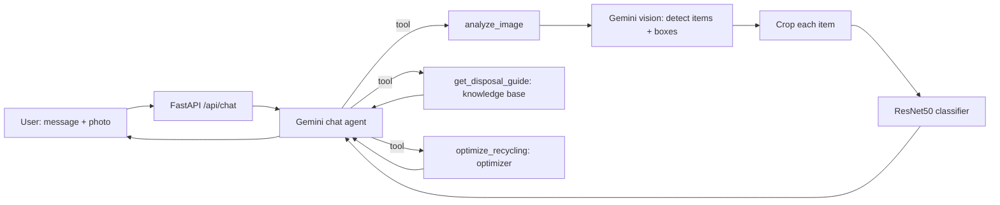

# Project Journey: from first notebook to agentic system

**Title:** Waste Classification and Recycling Optimization Using Agentic AI and Computer Vision

This document records how the project started (version 1), what was wrong with it, and how it is built now (version 2). It is written to support the project review: every number below comes from a run that was actually executed.

---

## 1. At a glance

| | Version 1 (first Colab notebook) | Version 2 (current) |
|---|---|---|
| Goal | Classify a waste photo into 5 classes | Chat with an agent that identifies waste, explains disposal and optimizes recycling |
| Classes | cardboard, glass, metal, paper, plastic (`trash` removed) | the same plus `trash`; the agent adds organic, battery, e-waste, textile |
| Data split | 80/20 train/validation, no test set, no seed | 70/15/15 train/val/test, stratified, seeded (42) |
| Validation images | Augmented (a bug) | Never augmented |
| Model selection | Best epoch by validation accuracy, and that same number reported as the result | Best epoch by validation; test set scored once at the end |
| Class imbalance | Ignored | Class-weighted loss |
| Reported accuracy | 92.89% (validation, optimistic) | **93.42% (held-out test, Colab)**; 91.8% on the same split trained locally |
| Items outside the classes | Forced into one of 5 classes | Handled by the agent (override the CNN, extra categories) |
| Multiple items in one photo | One label for the whole image | Each item detected, cropped and classified separately |
| Agentic AI | None | Gemini chat agent with tool calling |
| Recycling optimization | None | Optimizer: recovered share and CO2, as-is vs after prep steps |
| Interface | Notebook cells | Web chat app (FastAPI + HTML) |
| Explainability | None | Grad-CAM heatmaps |
| Code layout | One notebook | Python package, notebook, README, tests of the optimizer maths |

---

## 2. Version 1: the first notebook

**File:** `major_project_final (1).ipynb`, run entirely in Google Colab.

### What it did
1. Mounted Google Drive and read the dataset from `MyDrive/new datasets ` (the folder name has a trailing space).
2. Counted the images per class and drew a pie chart (excluding `trash`).
3. Loaded the images with `ImageFolder`, dropped the `trash` class, and used `random_split` for an **80/20** train/validation split.
4. Trained a **ResNet50** pretrained on ImageNet with a new 5-way output layer.
5. Ran two experiments:
   - **Experiment 1:** fine-tune all layers, Adam, learning rate 1e-4, up to 20 epochs. Best validation accuracy **92.89%** (epochs 4 and 7).
   - **Experiment 2:** freeze everything except `layer4`, learning rate 5e-5, up to 20 epochs. Best validation accuracy about **91%**.
6. Showed sample predictions and a confusion matrix, then saved the weights to Drive.

### Dataset
2,527 JPG images, 47 MB:

| Class | Images |
|---|---|
| paper | 594 |
| glass | 501 |
| plastic | 482 |
| metal | 410 |
| cardboard | 403 |
| trash (excluded in v1) | 137 |

### Problems found in version 1
Found by reading the notebook code and outputs:

1. **No test set.** The 92.89% is a validation number, and the best epoch was picked using that same number, so it is optimistic.
2. **Augmented validation images.** The validation subset came out of `random_split` on a dataset that carried the training transform (random flips, rotations, colour jitter), so validation was measured on distorted images.
3. **Overwritten checkpoint.** Both experiments saved to the same file, `best_model.pth`, so the weaker model could overwrite the stronger one.
4. **Inconsistent preprocessing.** Experiment 1 trained without ImageNet normalization while the inference cell normalized its inputs.
5. **No handling of items outside the classes.** `trash` was removed with a label-shifting workaround, so a banana peel or a battery was forced into one of five recyclable classes.
6. **Classification only.** There was no agent, no recycling advice, no optimization, and nothing deployable.

---

## 3. Version 2: how it is built now

### 3.1 The vision model (trained in Colab and locally)

Notebook: `notebooks/train_colab.ipynb` (mirrors `src/train.py`).

| Step | What it does |
|---|---|
| 1. Setup and data | Mounts Drive, copies the dataset, counts images, plots the class distribution |
| 2. Split | Stratified, seeded 70/15/15: 1,768 train, 379 validation, 380 test |
| 3. Model | ResNet50 (ImageNet weights) with a new 6-way head, AdamW, cosine schedule, mixed precision |
| 4. Training | Class-weighted loss, light augmentation on train only, best checkpoint by validation accuracy, early stopping after 5 epochs without improvement |
| 5. Curves | Train vs validation loss and accuracy per epoch |
| 6. Test evaluation | Scored once on the 380 held-out images; classification report, confusion matrix, per-class precision and recall chart |
| 7. Sample predictions | Random test images, wrong predictions in red |
| 8. Grad-CAM | Heatmaps of where the network looks |
| 9. Save | `best_model.pth`, `classes.json`, `metrics.json`, downloaded as `weights.zip` |

**Results on the held-out test set (Colab run): accuracy 93.42%**

| Class | Precision | Recall | Test images |
|---|---|---|---|
| cardboard | 0.95 | 0.93 | 60 |
| glass | 0.94 | 0.95 | 76 |
| metal | 0.90 | 1.00 | 62 |
| paper | 0.94 | 0.91 | 89 |
| plastic | 0.96 | 0.90 | 73 |
| trash | 0.90 | 0.90 | 20 |

The same code trained locally on an RTX 3050 gave 91.8% on the same split. The 1.6-point gap comes from GPU, library versions and random augmentation, so "about 92-93%" is the fair way to say it. The `trash` figures rest on only 20 test images and are rough.

### 3.2 The agent



How a conversation works:
1. The chat greets the user and asks for a photo.
2. On upload, `analyze_image` asks Gemini to detect each distinct item with a bounding box, crops each one, and sends each crop through the trained ResNet50.
3. The agent compares each CNN answer with the photo. It overrides the CNN when confidence is below 0.6, when the item is outside the CNN's six materials (food, battery, electronics, clothing), or when the answer is clearly wrong, and it says when it does so.
4. It calls `get_disposal_guide` for each final category to get the bin, the steps, the decomposition time and what to avoid.
5. It judges contamination from the photo (none, light, heavy) and calls `optimize_recycling` once with all items.
6. It answers with: the category per item, a plan grouped by bin, how the items break down, what to avoid, and the optimization result. Follow-up questions use the conversation memory.

### 3.3 The optimizer

`src/optimizer.py` is plain deterministic code, not the language model, so the numbers cannot be invented. For the same set of items it compares two scenarios:

- **As-is:** contaminated recyclables are rejected at sorting, so they count as not recovered.
- **After prep:** the user follows the prep steps. Lightly contaminated items (food residue) are rinsed and recovered. Heavily contaminated paper or cardboard (grease, wet) can salvage the clean half. Other heavily contaminated items are lost.

It returns items grouped by bin, the recovered share of waste by weight (as-is and after prep), CO2 avoided in both cases, and the list of prep actions. Worked example from the test: a glass bottle, a dirty can, a greasy pizza box, a banana peel and a tissue give 65.0% recovered as-is and 79.7% after prep, a gain of 14.7 points.

Assumptions to state at the review:
- Item weights are typical values unless the user states them.
- CO2 factors are rough, illustrative figures, not audited data.
- The contamination rules are simple and are this project's own assumptions.

### 3.4 Files

| Path | Purpose |
|---|---|
| `src/train.py` | Training script (same logic as the Colab notebook) |
| `src/classifier.py` | Loads the ResNet50 once and classifies an image |
| `src/knowledge.py` | Disposal guides and CO2 factors for 10 categories |
| `src/optimizer.py` | As-is vs after-prep recycling optimization |
| `src/agent.py` | Gemini chat agent, item detection, tools |
| `src/api.py` | FastAPI app (`/api/chat`, `/api/classify`) |
| `static/index.html` | Chat page |
| `notebooks/train_colab.ipynb` | Colab training notebook with all plots |
| `weights/` | `best_model.pth`, `classes.json`, `metrics.json`, `confusion_matrix.png` |

Run it locally:

```bash
python -m venv .venv
.venv\Scripts\pip install torch torchvision --index-url https://download.pytorch.org/whl/cu124
.venv\Scripts\pip install google-genai fastapi "uvicorn[standard]" python-multipart python-dotenv scikit-learn matplotlib pillow tqdm
copy .env.example .env      # then put your Google AI Studio key in .env
.venv\Scripts\python -m uvicorn src.api:app --port 8000
```

Open `http://127.0.0.1:8000`.

---

## 4. Problems met while building version 2, and the fixes

| Problem | Cause | Fix |
|---|---|---|
| `429 RESOURCE_EXHAUSTED` in the chat | Free-tier daily request cap on the Gemini model (20 requests per day for `gemini-2.5-flash`) | Switched models through `GEMINI_MODEL`; the cap applies per model |
| `503 UNAVAILABLE` | Temporary Gemini overload | Automatic retry with backoff |
| "Failed to parse URL /api/chat" | The page was opened as a file instead of through the server | Open `http://127.0.0.1:8000` |
| Agent skipped the disposal guide and guessed a weight | Prompt too loose | Prompt now requires the tools, and weights are never guessed |
| Local test hung on Windows | Data-loader worker processes re-ran the script | Zero workers on Windows, two on Colab |
| API key pasted into a chat | Human error | Key kept only in a git-ignored `.env`; it should be rotated |

---

## 5. What is done and what is left

| Part of the title | Status |
|---|---|
| Waste classification with computer vision | Done: 93.4% held-out test accuracy |
| Agentic AI | Done: chat agent with tool calling, multi-item, out-of-scope items |
| Recycling optimization | Done in a simple form: recovered share and CO2, as-is vs after prep |
| README and GitHub deployment | Still to do |
| Real-world photo test | Done on 29 openly licensed Wikimedia Commons photos (see section 6) |

---

## 6. Real-world test (photos outside the dataset)

Set: 33 openly licensed photos from Wikimedia Commons (licences and authors in `data/real_world/SOURCES.csv`), 29 scored single-item photos plus 4 mixed-scene photos that are not scored. Keyword search returned some wrong matches (sheet music for "textile", an excavator for "paper"); those were removed by hand, so **there are no textile photos**. Reproduce with `python -m src.eval_real_world --agent`.

| System | Photos | Correct |
|---|---|---|
| CNN alone, its own 6 classes | 19 | 12 (63%) |
| Full agent, same 19 photos | 19 | 16 (84%) |
| Full agent, items the CNN was never trained on (battery, e-waste, food) | 10 | 8 (80%) |
| Full agent, all scored photos | 29 | 24 (83%) |

Hazardous items (added later, 5 openly licensed photos: paint can with brush, two medicine photos, aerosol can, X-ray of CFL bulbs): the agent identified the hazardous item in **5 of 5** photos. Strict scoring gives 3 of 5, because the medicine photos also contain a glass jar that the agent sensibly labelled glass, and one extra item was labelled trash. The CNN has no hazardous class, so these photos only work through the agent. The set is tiny and the CFL photo is an X-ray, so treat this as a smoke test, not an accuracy figure.

What it shows:
- The CNN falls from 93% on dataset photos to 63% on web photos. Its training photos are clean, single items on plain backgrounds, so it does not transfer well to cluttered photos.
- The agent recovers most of that gap, because Gemini sees the photo and overrides the CNN. Part of the credit therefore goes to Gemini's vision, with the CNN acting as one tool.
- `trash` is the weakest class: the CNN got 0 of 4 (litter and styrofoam cups read as cardboard or paper) and the agent got 2 of 4.
- The CNN made confident mistakes: a battery as metal at 99% and a banana peel as cardboard at 96%.
- Scoring is strict: a photo counts as correct only if every detected item gets the true category. Several of the misses are arguable (a wrapper called plastic, a food container with leftovers split into organic and plastic).
- The set is small (29 photos), so the percentages are rough. Phone photos taken by the team would make stronger evidence.

Known limitations:
- The classifier was trained on clean, single-item photos from one dataset; cluttered real-world photos will score lower.
- The agent depends on the Gemini API, whose free tier has daily limits.
- The optimizer uses typical weights and simple contamination rules, so its percentages are estimates.
- Disposal advice is general; local recycling rules differ.
