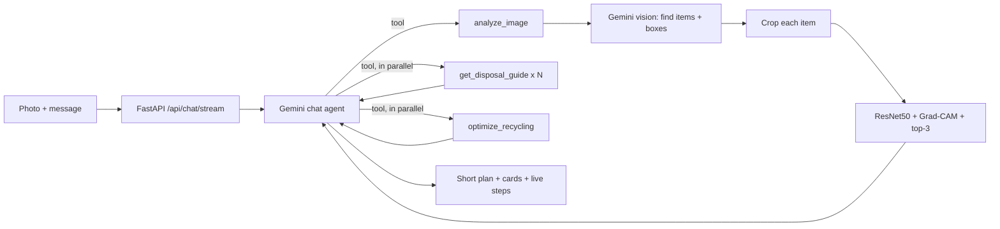

# Project Journey: from the first notebook to a deployed agent

**Title:** Waste Classification and Recycling Optimization Using Agentic AI and Computer Vision

This document records what was built, in order: **V1** (the first Colab notebook), **V2** (the corrected training pipeline, in Colab and locally) and **V3** (the agentic web app that works today), plus how it is deployed, what went wrong along the way, and what the honest numbers are. Every figure comes from a run that was actually executed.

---

## 1. The three versions at a glance

| | V1: first Colab notebook | V2: corrected training | V3: agentic web app (now) |
|---|---|---|---|
| Goal | Label a photo with one of 5 classes | The same, but measured honestly | Chat with an agent that identifies waste, explains disposal and optimizes recycling |
| Classes | 5 (trash removed) | 6 (trash included) | 6 from the CNN plus 5 more the agent handles: organic, battery, e-waste, textile, hazardous (11 in total) |
| Data split | 80/20, random, no seed | 70/15/15, stratified, seeded | same weights as V2 |
| Validation images | augmented (bug) | never augmented | n/a |
| Reported accuracy | 92.89% on validation (optimistic) | **93.4%** on a held-out test set (Colab), 91.8% local | 93.4% on dataset photos, **83%** for the agent on outside photos |
| Several items in one photo | no | no | yes: each item detected, cropped and classified |
| Items outside the classes | forced into a class | forced into a class | the agent overrides the CNN |
| Agentic AI | none | none | Gemini chat agent with tool calling |
| Recycling optimization | none | none | as-is vs after-prep recovery and CO₂ |
| Interface | notebook cells | notebook plots | web chat app + Insights page |
| Deployment | none | none | Dockerfile, GitHub repo, public link through a laptop tunnel |

---

## 2. V1: the first Colab notebook

**File:** `major_project_final (1).ipynb`, run in Google Colab.

**What it did**
1. Mounted Google Drive and read `MyDrive/new datasets ` (the folder name has a trailing space).
2. Counted images per class and drew a pie chart (excluding `trash`).
3. Loaded the photos with `ImageFolder`, dropped the `trash` class, and split 80/20 with `random_split`.
4. Trained a ResNet50 pretrained on ImageNet with a new 5-way output layer.
5. Ran two experiments:
   - Fine-tune all layers, Adam, lr 1e-4, 20 epochs planned. Best validation accuracy **92.89%** (epochs 4 and 7).
   - Freeze everything except `layer4`, lr 5e-5, 20 epochs planned. Best validation accuracy about 91%.
6. Showed sample predictions and a confusion matrix; saved weights to Drive.

**Dataset** (2,527 JPG images, 47 MB; the class counts match the public TrashNet dataset):

| Class | Images |
|---|---|
| paper | 594 |
| glass | 501 |
| plastic | 482 |
| metal | 410 |
| cardboard | 403 |
| trash (excluded in V1) | 137 |

**Problems found in V1** (by reading its code and outputs)
1. **No test set.** 92.89% is a validation number, and the best epoch was chosen using that same number.
2. **Augmented validation images.** The validation subset came from `random_split` on a dataset carrying the training transform (random flips, rotations, colour jitter).
3. **Overwritten checkpoint.** Both experiments saved to the same `best_model.pth`.
4. **Inconsistent preprocessing.** Experiment 1 trained without ImageNet normalization, but the inference cell normalized.
5. **No path for unknown items.** `trash` was removed with a label-shifting workaround, so a banana peel would be forced into a recyclable class.
6. **Classification only.** No agent, no advice, no optimization, nothing deployable.

---

## 3. V2: corrected training (`notebooks/train_colab.ipynb`, `src/train.py`)

**What changed**

| Step | V2 |
|---|---|
| Classes | 6, `trash` included |
| Split | stratified, seeded (42): 1,768 train, 379 validation, 380 test |
| Augmentation | on the training set only (random crop 0.7-1.0, flip, rotation 20, colour jitter); validation and test only resized |
| Model | ResNet50 (ImageNet weights), new 6-way head |
| Optimizer | AdamW (lr 1e-4, weight decay 1e-4), cosine schedule, mixed precision |
| Imbalance | class-weighted cross-entropy |
| Selection | best epoch by validation accuracy, early stopping after 5 epochs without improvement |
| Final score | the test set is scored **once**, at the end |
| Extras | training curves, per-class precision and recall, sample predictions (wrong ones in red), Grad-CAM heatmaps |

**Results on the held-out test set (Colab run, 380 photos): 93.42% accuracy**

| Class | Precision | Recall | Test photos |
|---|---|---|---|
| cardboard | 0.95 | 0.93 | 60 |
| glass | 0.94 | 0.95 | 76 |
| metal | 0.90 | 1.00 | 62 |
| paper | 0.94 | 0.91 | 89 |
| plastic | 0.96 | 0.90 | 73 |
| trash | 0.90 | 0.90 | 20 |

The same code trained locally on an RTX 3050 gave **91.8%** on the same split (best validation 95.3% at epoch 8). The 1.6-point gap comes from hardware, library versions and random augmentation, so "about 92 to 93%" is the fair statement. The `trash` figures rest on only 20 photos.

**What the V2 notebook shows:** class distribution chart, loss and accuracy curves, test confusion matrix, per-class precision and recall chart, a 15-photo prediction grid, Grad-CAM heatmaps, then it downloads `weights.zip`.

---

## 4. V3: how the system works now

### 4.1 The flow of one photo

1. **Detect.** Gemini vision finds each distinct item (at most 6) and returns a name and a bounding box.
2. **Classify.** Each crop goes through the trained ResNet50 (under 1 second for all items): top-3 guesses and a Grad-CAM heatmap.
3. **Verify.** The agent compares each CNN answer with the photo and **overrides** it when confidence is below 0.6, when the item is outside the CNN's six classes (food, batteries, electronics, clothing, hazardous), or when the answer is clearly wrong.
4. **Advise and optimize.** In one parallel step the agent looks up the disposal guide for every final category and runs the optimizer.
5. **Answer.** A short reply (about 100 words) with the steps; the page shows the details as cards.

### 4.2 The agent's tools

| Tool | Does |
|---|---|
| `analyze_image` | Detects items, crops them, classifies each with the CNN, returns names, boxes, confidences and top-3 |
| `get_disposal_guide` | Returns the bin, the steps, decomposition time and what to avoid for one of the 11 categories |
| `optimize_recycling` | Runs the optimizer on all items and returns the bin grouping, recovered share and CO₂ |

The 11 categories: cardboard, glass, metal, paper, plastic, trash (from the CNN) and organic, battery, e-waste, textile, hazardous (agent only). Hazardous covers paint and solvents, chemicals, pesticides, bleach, aerosols, bulbs and tubes, medicines, needles and oil; its guidance opens with a safety warning.

### 4.3 The optimizer (`src/optimizer.py`)

Plain code, so the numbers cannot be invented by the language model. For the same set of items it compares:
- **As-is:** contaminated recyclables (cardboard, glass, metal, paper, plastic) are rejected at sorting.
- **After prep:** lightly contaminated items (food residue) are rinsed and recovered; heavily contaminated paper or cardboard (grease, wet) salvages the clean half; other heavily contaminated items are lost.

Output: items grouped by bin, recovered share of waste by weight (as-is and after prep), CO₂ avoided in both cases, and the prep actions. Example: a glass bottle, a dirty can, a greasy pizza box, a banana peel and a tissue give 65.0% recovered as-is and 79.7% after prep. Weights are typical values unless the user states them, CO₂ factors are rough illustrative figures, and the contamination rules are this project's own simple assumptions.

### 4.4 The web app

| Part | What it does |
|---|---|
| Chat page (`static/index.html`) | Drag, drop or paste a photo; live trail of the agent's real steps (streamed from the server); coloured boxes on your photo; item cards (CNN guess with confidence bar and top-3, agent override badge, contamination level, Grad-CAM thumbnail, breakdown time, what to avoid); bin cards with a "find a drop-off near me" link; animated as-is vs after-prep bars; session score (items, CO₂, recovered share); dynamic follow-up suggestions; error card with "Try again"; light and dark themes that follow the system |
| Insights page (`/insights`) | Headline numbers, dataset vs real-world comparison, per-class table, confusion matrix, training curves, architecture and limits |
| API (`src/api.py`) | `/api/chat`, `/api/chat/stream` (newline-delimited JSON step events), `/api/classify`, `/api/insights`, `/api/confusion-matrix.png`; uploads limited to jpg, png or webp up to 8 MB |
| Visitor limits | 40 requests an hour per visitor and 250 a day for the site, so a public link cannot drain the Gemini quota |

The interface follows a redesign made in Claude Design (Bricolage Grotesque, Instrument Sans and JetBrains Mono; a lime accent; an 11-colour category system). The three font files ship with the app so it works offline.

### 4.5 Speed and reliability

Measured on the same multi-item photo:

| | Before | After |
|---|---|---|
| Total time | 83 s (5 sequential Gemini calls of 14 to 18 s) | 11 to 35 s, depending on which model has quota |
| One run once hung | 364 s and returned an empty answer | bounded: each call is cut off after 20 s |

What changed:
- All tool calls after detection are made in **one step**, not one after another.
- Photos are **shrunk to 1024 px** before being sent to Gemini (boxes are stored as fractions, so the page is unaffected).
- The written answer is **short**, because the cards already show category, breakdown, bins and numbers.
- A **model ladder** with a 20-second limit per call: `gemini-3-flash-preview`, then `gemini-3.5-flash`, `gemini-flash-lite-latest`, `gemini-3.1-flash-lite`. A slow, overloaded, out-of-quota or empty-answer model is skipped and the turn is replayed cleanly on the next one.
- The detection result is **cached** so a model switch does not pay for it twice.

The CNN itself takes under a second. Most of the remaining delay is Google's free tier (quota and load), not the application.

---

## 5. How well it works

### 5.1 Outside the dataset (29 scored photos from Wikimedia Commons, open licences; sources in `data/real_world/SOURCES.csv`)

| System | Photos | Correct |
|---|---|---|
| ResNet50 alone, its own 6 classes | 19 | 12 (63%) |
| Full agent, the same 19 photos | 19 | 16 (84%) |
| Full agent, items the CNN never learned (battery, e-waste, food) | 10 | 8 (80%) |
| Full agent, all scored photos | 29 | 24 (83%) |
| Hazardous items (5 extra photos, a smoke test) | 5 | identified 5 of 5; strict scoring 3 of 5 |

Reading the numbers:
- The CNN falls from 93% on dataset photos to 63% on cluttered photos. The agent's second look with Gemini recovers most of the gap, so part of the credit belongs to Gemini's vision; the CNN is one tool inside the agent.
- `trash` is the weakest class (CNN 0 of 4 on web photos, agent 2 of 4).
- The CNN can be confidently wrong (a battery called metal at 99%, a banana peel called cardboard at 96%).
- Scoring is strict: a photo counts only if every detected item gets the true category, so several misses are arguable.
- The set is small and has **no textile photos** (every web match was wrong), so the percentages are rough. Reproduce with `python -m src.eval_real_world --agent`.

### 5.2 Limits to state openly
- The classifier was trained on about 2.5k clean photos from one dataset.
- Detection and the final check depend on the Gemini API and its free-tier daily limits; photos are sent to Google for analysis.
- CO₂ and recovery figures are estimates from typical weights and simple rules.
- Hazardous items were checked on five photos, textiles on none.
- Disposal advice is general; local rules differ.

---

## 6. Deployment

| Deliverable | Status |
|---|---|
| **Dockerfile** | Written (`python:3.12-slim`, CPU PyTorch 2.7.1, listens on port 7860). Its pinned packages have Linux wheels, and the weights load and classify correctly on that PyTorch version. It has **not been built**, because Docker is not installed on the development PC. |
| **GitHub repo** | Pushed to **https://github.com/Sharan-6905/cmritcse** (branch `main`): code, README with run, Docker and deployment instructions, dataset (`data/raw`, `data/real_world`), weights (90 MB as a normal file, no Git LFS), notebook. `.env` is excluded, so the API key is not in the repo. |
| **Project URL** | A public link through a **laptop tunnel**: double-click `start_demo.bat`, which starts the app and a free Cloudflare quick tunnel and prints a `https://…trycloudflare.com` address. The link works only while the laptop is on, awake and online, and it changes on every start. A permanent link would need Google Cloud Run or a paid Hugging Face plan. |

**Why not Hugging Face Spaces:** the deploy script (`deploy_hf.py`) was ready, but Hugging Face answered `402 Payment Required`: Docker Spaces on the free CPU tier now need a PRO subscription. Nothing was created or uploaded. Vercel was ruled out because PyTorch exceeds its function size limit and requests run for tens of seconds.

---

## 7. Problems met along the way, and the fixes

| Problem | Cause | Fix |
|---|---|---|
| 429 `RESOURCE_EXHAUSTED` in the chat | Free-tier daily request caps, per model | Model ladder with automatic fallback |
| 503 `UNAVAILABLE` and very slow answers | Google capacity at busy times | Time limits per call plus the same ladder |
| Agent skipped the disposal guide and guessed a weight | Prompt too loose | Prompt now requires the tools and forbids guessing weights |
| Hazardous items were filed as "trash" | No hazardous category | Added the category, guide, colour and safety banner |
| Cards missing after a model switch | The replacement model did not redo the tools | Replay the turn from the conversation as it was before |
| Bin chips mis-numbered when items shared a name | Matching by name | Bin grouping now uses item indexes |
| Wrong web photos from keyword search (sheet music for "textile") | Search matches words, not content | Photos reviewed by eye; bad ones removed |
| PyTorch 2.6.0 missing from the CPU wheel index | Index only keeps newer versions | Dockerfile pinned to 2.7.1 and tested |
| Local test hung on Windows | Data-loader workers re-ran the script | Zero workers on Windows, two on Colab |
| API key and a Hugging Face token pasted into chat | Human error | Both must be rotated; keys live only in `.env` and are never committed |

---

## 8. Repository map

| Path | Purpose |
|---|---|
| `README.md` | Overview, results, run, Docker and deployment instructions |
| `Dockerfile`, `requirements.txt`, `.dockerignore` | Container build |
| `src/train.py` | Training script (V2) |
| `src/classifier.py` | Loads ResNet50, classifies, Grad-CAM |
| `src/agent.py` | Gemini chat agent, tools, model ladder, progress events |
| `src/optimizer.py` | As-is vs after-prep recovery and CO₂ |
| `src/knowledge.py` | Disposal guides, short card text, CO₂ factors |
| `src/api.py` | FastAPI app, streaming, rate limits |
| `src/eval_real_world.py` | Out-of-dataset evaluation |
| `static/` | Chat page, Insights page, fonts |
| `notebooks/train_colab.ipynb` | V2 training notebook with all plots |
| `weights/` | Trained weights, classes, metrics, result summaries |
| `data/` | Training photos and the real-world test photos |
| `deploy_hf.py`, `start_demo.bat` | Local helpers (Hugging Face upload; one-click app and tunnel) |

---

## 9. Where it stands

| Part of the title | Status |
|---|---|
| Waste classification with computer vision | Done: 93.4% on held-out test photos |
| Agentic AI | Done: tool-calling chat agent, multi-item, out-of-class items, hazardous items |
| Recycling optimization | Done in a simple form: recovered share and CO₂, as-is vs after prep |
| Dockerfile, GitHub repo, README | Done (Dockerfile not yet built) |
| Project URL | Available through the laptop tunnel; no permanent hosting |

Open items: rotate the exposed API keys, build the Dockerfile once on a machine with Docker, and decide on permanent hosting.

---

## 10. Review 3: how the project answers each evaluation criterion

### Functionality (10 marks): all features implemented and functioning correctly

| Feature | Works | Evidence |
|---|---|---|
| Identify waste from a photo | Yes | ResNet50, 93.4% on 380 held-out test photos |
| Several items in one photo | Yes | Each item found, boxed, cropped and classified separately |
| Items the model never learned (food, battery, e-waste, clothes, hazardous) | Yes | The agent overrides the CNN; 8 of 10 correct on outside photos |
| Disposal guidance | Yes | Bin, numbered steps, breakdown time and what to avoid for 11 categories; safety warning for hazardous items |
| Recycling optimization | Yes | Recovered share and CO₂, as-is vs after prep steps |
| Explainability | Yes | Grad-CAM heatmap per item; top-3 guesses with confidence |
| Chat with memory and follow-ups | Yes | Suggested next questions change with every answer |
| Live progress | Yes | The page shows the agent's real steps as they happen |
| Visitor protection and failover | Yes | Rate limits; automatic fallback across four Gemini models |

Honest limits to say out loud: textiles are untested, hazardous items were checked on only five photos, and the CO₂ and recovery figures are estimates.

### Deployment & Demo (10 marks): live link accessible, functional and deployed in the cloud

| Item | Status |
|---|---|
| Code and documentation | GitHub: https://github.com/Sharan-6905/cmritcse (README, code, dataset, deployment instructions) |
| Container | `Dockerfile` written; packages and weights verified on the container's PyTorch version; not yet built because Docker is not installed on the development PC |
| Live link today | A public `https://…trycloudflare.com` link made by `start_demo.bat`. It serves the app **from the presenting laptop** through a Cloudflare tunnel. |
| Cloud hosting | **Not yet.** Hugging Face now charges for Docker Spaces (HTTP 402), so the free route was closed. |

**Be clear about the gap:** the rubric says "deployed in the cloud". A laptop tunnel gives a working public link, but the app still runs on the laptop, so an evaluator could say it is not cloud-deployed. To earn the full marks, deploy the same Dockerfile to a cloud service: **Google Cloud Run** (free tier covers a demo; needs a billing account with a card) or **Hugging Face PRO** (about $9 a month, cancel after the review). Keep the laptop tunnel only as the backup.

### Innovation (10 marks): novelty and social impact

**Novelty**
- A trained vision model **and** a language-model agent work together: the CNN is the specialist, the agent double-checks it against the photo and overrides it when it is wrong or the item is outside what it learned. Measured: on outside photos the CNN alone scored 63% and the combined system 84%.
- The optimizer compares "put it in as-is" with "after prep steps", so the app tells you not only the bin but how much more is recovered if you rinse, separate the lid or tear off the greasy part.
- It handles several items in one photo and covers 11 categories, including hazardous waste with a safety-first warning.
- It is explainable (heatmaps, top-3 guesses, "agent override" badges) and honest about its limits (Insights page, estimates labelled as estimates).

**Social impact**
- Wrong sorting and dirty items spoil recyclable material, so clear, photo-based guidance at home helps more waste get recycled.
- Hazardous items (batteries, paint, bulbs, medicines, sharps) are handled with explicit "never in a household bin or drain" advice, which protects people and waterways.
- Works from a phone photo, in plain language, with no training needed, so it is usable by anyone.
- Shows an estimated CO₂ benefit, which makes the effect of small habits visible.

### UI/UX (10 marks): quality of interface and ease of use
- One clear action on the first screen: drop, paste or choose a photo. Few buttons by design.
- Live trail of what the agent is doing, so waiting never feels like a freeze.
- Results are layered: a short plan first, then cards for each item, the bins and the optimization.
- Every category has its own colour **and** a text label and number, never colour alone (accessible).
- Works on phones, follows the system light or dark theme, keyboard focus is visible, motion respects the "reduce motion" setting.
- Errors are friendly and recoverable ("Try again", the message is kept); suggested follow-up questions change with every answer.
- Built from a Claude Design redesign, then tested at desktop and phone width.

### Viva (10 marks): technical knowledge and ability to explain
Prepared through Sections 11 and 12 below: each team member has a topic they can explain in two to three minutes, with a plain-language example and likely questions.

---

## 11. Team split for the viva (Sharan, Sharath, Yashwanth)

This is a suggested split so everyone speaks, with the harder core on Sharan. Adjust it to who actually built what.

| Person | Topic | Level | Time |
|---|---|---|---|
| **Sharan** | The core: how the model is trained and tested properly, how the agent and tools work, the optimizer, why the numbers are what they are | Hardest | 5 to 6 min |
| **Sharath** | The data and the results: what the dataset is, the six classes, the train/validation/test split, accuracy and the confusion matrix, the per-class table | Simple | 2 to 3 min |
| **Yashwanth** | The product and delivery: what each screen does and how to use it, the Docker file, the GitHub repo, the live link and how it is deployed | Simple | 2 to 3 min |

Order of speaking in the review: Sharath (data and results) → Sharan (model and agent) → Yashwanth (live demo and deployment) → Sharan closes with limits and future work.

### Sharath: the data and the results (simple)

Talking points
1. The dataset has **2,527 photos** in six folders: cardboard 403, glass 501, metal 410, paper 594, plastic 482, trash 137.
2. The photos are split three ways: **70% to learn from, 15% to check progress, 15% kept hidden for the final test** (1,768, 379 and 380 photos).
3. The final score on the hidden photos is **93.4%** (91.8% when run again on a laptop GPU).
4. The **confusion matrix** shows which classes get mixed up (for example, some plastic is mistaken for metal).
5. Strongest class: metal recall 1.00. Weakest: plastic recall 0.90 and trash (only 20 test photos).

Real-life example: *"A student gets practice questions to learn, mock tests to check progress, and a final exam they have never seen. We only report the final exam score."*

Likely questions
- *Why not test on the photos you trained on?* Because the model could just remember them; the hidden photos show whether it really learned.
- *Why is trash weak?* It has the fewest photos (137).

### Yashwanth: the product and delivery (simple)

Talking points
1. **Using the app:** open the link, drop or paste a photo, watch the live steps, read the plan, the item cards and the bin cards. Ask follow-up questions in the chat.
2. **Screens:** the chat page, and the Insights page with the results.
3. **Docker:** the `Dockerfile` is a recipe that packages the app and everything it needs, so it runs the same on any machine: `docker build` then `docker run` with the Gemini key.
4. **GitHub:** the repo has the README, code, dataset and deployment instructions: https://github.com/Sharan-6905/cmritcse
5. **Live link:** how the demo link is started (`start_demo.bat`), and what the cloud deployment plan is.

Real-life example: *"Docker is a lunchbox: everything the app needs is packed inside, so it works wherever you open it."*

Likely questions
- *Is it deployed in the cloud?* Be honest about the current state (tunnel from the laptop) and the plan (Cloud Run or Hugging Face).
- *Where does the API key live?* In a private `.env` file or a cloud secret, never in the repository.

### Sharan: the core, in plain language (with real-life examples)

**1. Transfer learning (how the model learned with only 2.5k photos)**
We started from ResNet50, which had already learned shapes and textures from millions of photos. We replaced its final output layer with one for our six materials, then **fine-tuned the whole network** on our photos, with a small learning rate so it adjusts gently and does not forget what it knew.
*Example: hiring an experienced sorter who already recognises objects, and training them for one week on recycling instead of teaching a newborn from scratch.*

**1b. How the training works (what the notebook's training cell does)**
- One **epoch** is one full pass over the training photos. The model guesses, sees how wrong it was, and adjusts itself. We repeat this for up to 15 epochs.
- After every epoch it is tested on the **validation photos** (never used for learning). We keep the epoch with the best validation score.
- **Early stopping:** if the validation score does not improve for 5 epochs in a row, training stops, because more revision would only make it memorise.
- **Augmentation:** the training photos are randomly cropped, flipped, rotated and recoloured each time, so the model cannot memorise exact pictures. Validation and test photos are left untouched.
- **Class weights:** rarer classes (trash has only 137 photos) count a little more in the learning, so they are not ignored.
- At the very end, the hidden **test photos** are scored once. That is the 93.4%.
*Example: revision for an exam. Each epoch is one round of studying; the mock test (validation) shows whether you are improving; you stop when the mock marks stop rising; the real exam (test) is seen only once.*

**2. Why we fixed the first notebook (V1)**
V1 measured its score on photos that were also used to pick the best model, and those photos had been randomly flipped and recoloured. The number looked better than reality.
*Example: grading a student on the same practice questions they studied from.* In V2 the final test photos are untouched until the very end.

**3. Grad-CAM (explainability)**
It colours the parts of the photo that pushed the model to its answer.
*Example: asking the sorter to point at what they looked at to decide "this is glass".*

**4. What "agentic AI" means here**
A normal chatbot only talks. An agent has a **toolbox** and decides which tool to use and in what order. Ours (Gemini) has three tools:
- the eyes: `analyze_image` (find items, classify each with the trained model),
- the reference book: `get_disposal_guide`,
- the calculator: `optimize_recycling`.
*Example: a site manager who looks at the problem, asks the specialist (the CNN) for an opinion, double-checks it, consults the manual, and runs the numbers before giving you the plan.*

**5. Why the agent overrides the model**
The CNN only knows six materials, and it is confidently wrong sometimes (a battery called metal at 99%). The agent looks at the photo too and corrects it, and it covers food, batteries, e-waste, clothes and hazardous items.
*Example: a second opinion from a senior doctor.* Measured: CNN alone 63%, with the agent 84% on outside photos.

**6. The optimizer (the "recycling optimization" in the title)**
It is plain code, so the numbers can't be invented. A greasy or dirty item is rejected at the recycling plant; the same item rinsed is accepted.
*Example: a pizza box: binned as-is, the greasy part spoils it; tear off the clean lid and it is recycled.* The app shows "recovered as-is 38%" vs "after prep 86%" and the prep steps that get you there.

**7. Why the accuracy drops outside the dataset (93% to 63%)**
The model studied clean, single-item photos. Real photos are cluttered.
*Example: a student who only practised textbook diagrams meeting a messy real-life photo.* We say this openly and show it on the Insights page.

**8. Making it fast and reliable**
Each Gemini call can be slow or run out of free quota, so every call has a 20-second limit and the app falls back to the next of four models automatically. Photos are shrunk before upload, and independent tool calls run together.
*Example: a restaurant with backup suppliers, so one late delivery does not close the kitchen.* The live step trail is like a food-delivery tracker: you see each step as it happens.

**9. Honest limits (always end with these)**
Only about 2.5k clean training photos; depends on the Gemini API and its free limits; CO₂ and recovery numbers are estimates; hazardous and textile items are lightly tested; advice is general because local rules differ.

---

## 12. Viva question bank (short answers)

| Question | Short answer |
|---|---|
| What is the problem and why does it matter? | People mis-sort or contaminate recyclables, and hazardous items end up in bins. Photo-based guidance helps. |
| Why ResNet50? | A proven image model, pretrained on millions of photos; with only 2.5k photos, fine-tuning it works better than training from scratch. |
| What is the accuracy? | 93.4% on 380 photos kept hidden until the end (91.8% on a second run). |
| Why is there a gap between your numbers? | Different hardware and random augmentation; same code and same split. |
| What did you improve over the first notebook? | Added a real test set, stopped augmenting validation photos, added the trash class and class weights, then built the agent, optimizer and web app. |
| What is a confusion matrix? | A table of true class vs predicted class; the off-diagonal cells are the mistakes. |
| What is agentic AI? | A model that chooses tools and steps to reach a goal, not just a chatbot that replies. |
| Which tools does your agent use? | `analyze_image`, `get_disposal_guide`, `optimize_recycling`. |
| Why do you need Gemini if you trained a model? | The model knows six materials and can be confidently wrong; Gemini finds the items, double-checks, and covers everything else. Together they scored 84% vs 63% on outside photos. |
| How does the optimizer work? | It compares as-is with after-prep recovery using simple rules: rinse recovers lightly dirty items, tearing off greasy parts salvages half of heavily soiled paper or cardboard. Weights and CO₂ are estimates. |
| Is the CO₂ number accurate? | No, it is an estimate from typical weights and rough factors, and the app says so. |
| How do you handle several items or unknown items? | Detection finds and crops each item; the agent overrides the classifier for items outside its classes. |
| What are the limits? | Small clean dataset, depends on the Gemini API and its free limits, hazardous and textile lightly tested. |
| How is the API key protected? | Stored in a private `.env` file or a cloud secret, never in the repository. |
| What happens if Gemini is slow or out of quota? | Each call times out after 20 seconds and the app moves to the next of four models. |
| How is it deployed? | Dockerfile for the cloud; GitHub for the code; today a laptop tunnel for the live link, with Cloud Run or Hugging Face as the cloud option. |
| What would you do next? | More and messier training photos, test textiles and hazardous items properly, add a permanent cloud deployment and a mobile app. |

---

## 13. Suggested demo order (about 10 minutes)

1. **Sharan (30 s):** the problem and the title in one sentence.
2. **Sharath (2 to 3 min):** dataset, split, results, confusion matrix (Colab notebook or Insights page).
3. **Sharan (5 min):** V1 mistakes, V2 fixes, then the agent: upload a multi-item photo live and point at the trail, boxes, override badge, heatmap and the optimization bars.
4. **Yashwanth (2 min):** use the follow-up chips, show a hazardous item and the safety banner, then Docker, GitHub and the live link.
5. **Sharan (1 min):** the honest limits and next steps.

Before the review: run `start_demo.bat` at least 30 minutes early, test one photo, keep a screenshot of a good result as a backup, and do not run heavy tests so the Gemini free quota is still available.
